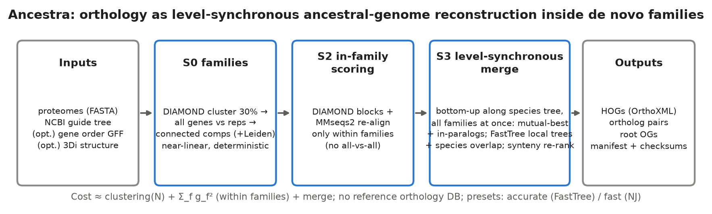
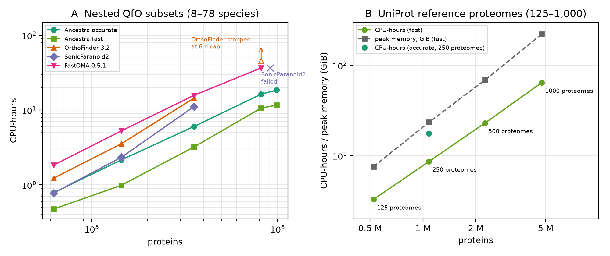

(Human-written text starts)
This is an exercise in assessing the bioinformatics capabilities of agentic AI. It is part of a hackathon run by the Beltrao lab at ETH Zurich, where we used Claude to run bioinformatics projects [LINK TO BE ADDED LATER]. All results in this project were generated entirely by AI with minimal human intervention. This is not intended to be viewed as a traditional publication and bioinformatics tool.

The goal of this specific project was to create a new orthology prediction method that included multiple data layers on top of protein sequence. It was executed by Claude Opus 5.5 with delegation to Opus 5.5/Sonnet 5.5 subagents, and finished within 48 hours on a computational cluster with 48 CPUs, 500GB RAM and A100 GPU.

Currently none of the results have been verified by a human. We plan to verify the agent’s methodology and benchmarking, and we will update this section accordingly.

The rest of this repository is entirely AI generated. It includes code for implementation of the predictive model and a AI-written report in the style of a journal article, detailing the final method, the path followed to reach it, and benchmarking against other methods.
(Human-written text ends)

## About this repository

This repository is the public minimal version of an exercise: can AI agents run a bioinformatics project end to end?
A Claude Opus 5.5 agent acted as principal investigator and delegated sub-tasks to Opus 5.5 and Sonnet 5.5 subagents.
The task given to the PI is in [`PROMPT.md`](PROMPT.md), copied verbatim: build a scalable orthology method that reports
hierarchical orthologous groups (HOGs) in OrthoXML, test extra data layers beyond sequence, and benchmark it against
community benchmarks and existing methods. The method (`ancestra/`) is frozen at tag **`freeze-v1`** of the research
repository [LINK TO BE ADDED]: the code here is a byte-identical copy of `ancestra/` at that tag. Everything else
(packaging, example, scripts, this text) was added afterwards without touching the method code. The research repository
holds the full record (design, literature review, research tree, lessons, claims, report).

Treat all numbers below as agent-generated and not yet verified by a human. The protocol deviations that the agents
disclosed are in [`docs/DISCLOSURES.md`](docs/DISCLOSURES.md); an independent agent re-computed the key numbers
([`docs/VERIFICATION.md`](docs/VERIFICATION.md)).

## What Ancestra does

Ancestra reconstructs ancestral gene sets along a guide species tree, one taxonomic level at a time, for all gene
families at once. (1) A family step (DIAMOND clustering, all genes against the cluster representatives,
connected components, a Leiden cap on giant components) puts proteins into homologous families without an all-versus-all
search or a reference database. (2) Sequence similarity is computed only inside families. (3) A level-synchronous merge
walks the tree bottom-up: at each node, the ancestral genes of the child lineages are merged by mutual best matches,
in-paralog absorption and repair rules, and ambiguous many-to-many clusters are resolved with a small local tree
(`accurate`: FAMSA + FastTree; `fast`: neighbour joining) labelled by species overlap. Each merged ancestral gene is a
HOG at that level. If gene order is supplied, ancestral gene-order context breaks ties between candidate partners and
vetoes absorptions that the context contradicts. The idea is not new: it descends from bottom-up methods such as SYNERGY
(Wapinski et al. 2007) and Hieranoid, and from OMA/FastOMA-style HOG inference (see `docs/` and the research repository's
`LITERATURE.md`). What Ancestra adds is a reference-free family step that feeds a merge over all families at
once, and the use of gene-order context inside the merge decision.



## Install

```bash
git clone <this repository> ancestra && cd ancestra
mamba env create -n ancestra -f environment.yml     # pinned versions of the research environment (linux-64)
conda activate ancestra
pip install -e . --no-deps                          # installs the `ancestra` command (also: python -m ancestra)
ancestra --help
python -m pytest -q -m "not slow"                   # 148 passed, 5 skipped (need benchmark data) in about 1 min
```

External programs called by the pipeline: DIAMOND 2.2.8, MMseqs2 18.8cc5c, FAMSA 2.4.1 and FastTree 2.2.0 (the
last two for `accurate` only); Foldseek only for the optional structure rescue. They come with `environment.yml`.
How this was tested: `pip install -e . --no-deps` and the unit tests were run in an isolated virtual environment layered
on the research conda environment; `environment.yml` was checked with a solver dry run (243 packages), not built from scratch.

## Quick start (about 20 s on 4 threads)

```bash
bash example/run_example.sh 4
```

This runs the frozen method (both presets, with gene order) on a seeded toy simulation (6 species, 1,828 proteins, exact
orthology truth in `example/data/truth/`), validates the OrthoXML with `scripts/verify_orthoxml.py`, scores it against the
truth, and regenerates `pairs.tsv` from the OrthoXML. Observed on 2026-10-27: ortholog-pair P/R/F1 = 0.9976/0.9122/0.9530 (`accurate`)
and 0.9979/0.9148/0.9545 (`fast`); all verifier checks that can run without benchmark code pass. This is a plumbing check on
an easy simulation (WAG model, no domain shuffling, no gene-model errors), not a benchmark result.

Your own data:

```bash
ancestra run --proteomes proteomes/ --tree guide_tree.nwk --out out/ --threads 8            # preset accurate (default)
ancestra run --proteomes proteomes/ --tree guide_tree.nwk --out out/ --threads 8 --preset fast
ancestra run ... --gene-order gene_order/                                                   # + synteny layer
```

Build the guide tree from the NCBI taxonomy (`taxdump.tar.gz`, public) restricted to your species:
`python -m ancestra.speciestree ncbi --proteomes proteomes/*.fa --taxdump taxdump/ --leaf-naming {ensembl|qfo} --out guide_tree.nwk`.
Check that the leaf names equal the proteome file stems.

## Presets and options

| flag | meaning | evidence in the frozen evaluation |
|---|---|---|
| `--preset accurate` (default) | FastTree (after FAMSA) local trees on the synteny-on pass, NJ on the synteny-off pass, plus species-overlap absorption at deep nodes | OrthoBench test F 76.2; about 1 CPU-h more than `fast` |
| `--preset fast` | NJ local trees everywhere, species-overlap structure and deep absorption | OrthoBench test F 74.8 (-1.4 [-7.1, +3.6] vs `accurate`); QfO TreeFam-A recall slightly higher than `accurate` |
| `--gene-order DIR` | Turns on the synteny layer (constrained re-ranking plus veto). One `<species>.parquet` per species; schema in `ancestra/genomes.py`; builders for Ensembl GFF3 and UniProt `gcoord` in `ancestra/genomes.py`, `ancestra/genomes_qfo.py` | Used in all reported runs. No measurable effect on OrthoBench test (-0.1 [-0.4, 0.0] F when removed) or on QfO recall (docs/DISCLOSURES.md items 12, 17) |
| `--family-rescue {none,3di,profile,both}` `--family-rescue-guard` `--structure-3di FASTA` | Optional rescue of small S0 families into the best remote-homology family (3Di structure strings and/or profiles). Off by default | OrthoBench test F -5.0 [-13.1, 0.0] when on (precision falls); no QfO gain. Kept as an option only |
| `--backend`, `--config`, `--family-config`, `--families TSV` | Advanced: scoring backend, config overrides, precomputed families | see `python -m ancestra run --help` |

## Input and output formats

**Input.**
- `--proteomes DIR`: one FASTA per species (`.fa .fasta .faa .fas .pep`, `.gz` allowed). The species name is the file stem and
  must equal a leaf name of the guide tree. `sp|ACC|NAME` headers are reduced to `ACC`. Protein IDs must be unique across
  species. One protein per gene is expected (e.g. the canonical isoform); the pipeline does not choose isoforms.
- `--tree FILE`: rooted Newick guide species tree; internal node names become the HOG levels (OrthoXML `TaxRange`). Multifurcations
  are merged k-way. Leaves without a proteome are pruned; a proteome missing from the tree is an error.
- `--gene-order DIR` (optional): `<species>.parquet` with columns `protein_id, gene_id, contig, start, end, strand, order, contig_n, primary, source`.
  Species without a table get no synteny evidence.

**Output** (in `--out`):

| file | content |
|---|---|
| `hogs.orthoxml` | primary output: OrthoXML 0.5, XSD-validated at write time; nested `orthologGroup`/`paralogGroup` with `TaxRange` = lowest guide-tree level of the members; includes a `<taxonomy>` block. Loads in pyham. |
| `pairs.tsv` | secondary export derived from the HOGs: `#gene_a  gene_b  level`, ortholog pairs by the QfO flattening rule (deepest common group is an orthologGroup) |
| `orthobench_ogs.txt` | root-level groups in the Open OrthoBench input format |
| `manifest.json` | provenance: versions, git commit, argv, config, input md5, per-stage wall time and RSS, output md5 |
| `stages/` | checkpoints (`input`, `families`, `scores`, `merge`, `output`); a rerun skips unchanged stages, so a merge-only change reruns only merge and output; `--force` recomputes |

Validate any output with `python scripts/verify_orthoxml.py OUT_DIR`. Regenerate the pairs from an OrthoXML with
`python scripts/orthoxml_to_pairs.py hogs.orthoxml.gz pairs.tsv.gz`.

## Predictions of the frozen method

[`predictions/`](predictions/README.md) holds the gzipped outputs that were scored in the final evaluations (OrthoBench and
QfO 2022, `accurate` and `fast`), with manifests, verification reports, checksums and the exact command lines.
`inputs/` holds the guide trees and the gene-order tables (derived from Ensembl 99 GFF3 and UniProt gene coordinates)
so the runs can be repeated. The QfO pair files are not included (see `predictions/README.md` to regenerate them).

## Reproduce the benchmarks

Raw data are not in this repository. Layout expected by the scripts: everything under `data/` (or set `DATA_DIR`). Versions,
checksums and licences: [`docs/DATA.md`](docs/DATA.md). Benchmark wrappers (upstream scoring code unmodified) are in
[`bench/`](bench/README.md).

**Score the shipped predictions (no re-run needed).**

```bash
export DATA_DIR=/path/to/data
# OrthoBench (needs the Open_Orthobench checkout, small): about 1 min
bash bench/scripts/download_orthobench.sh
zcat predictions/orthobench/accurate/orthobench_ogs.txt.gz > /tmp/ob_accurate.txt
bash bench/scripts/run_orthobench.sh /tmp/ob_accurate.txt ancestra_accurate     # prints all/dev/test F, P, R (test: 76.19)
# QfO 2022 (needs 3.3 GB reference data, the benchmark-webservice code and Darwin): hours for the STD/G_STD2 tests
bash bench/scripts/download_qfo.sh all
bash bench/scripts/run_qfo_local.sh -i predictions/qfo2022/accurate/hogs.orthoxml.gz -n Ancestra_accurate -j 4
```
Re-checked when this repository was assembled: scoring the shipped OrthoBench files gives test F 76.19 (`accurate`) and 74.79
(`fast`), equal to `results/orthobench_final/summary.md`. The QfO scoring was not repeated here. The dev/test split of the 70 RefOGs
(by homology component, seed 11) is `splits/`.

**Re-run the method.**

```bash
# OrthoBench (12 proteomes, 251k proteins; about 30 min on 10 threads, 14 GB RAM)
ancestra run --proteomes $DATA_DIR/orthobench/Open_Orthobench/BENCHMARKS/Input \
    --tree inputs/orthobench/guide_tree.nwk --gene-order inputs/orthobench/gene_order \
    --preset accurate --threads 10 --out runs/ob_accurate
bash bench/scripts/run_orthobench.sh runs/ob_accurate/orthobench_ogs.txt ancestra_accurate

# QfO 2022 (78 proteomes, 989k proteins; about 30 GB RAM; S0+S2 about 1.5 h and the accurate merge about 50 min at 12 threads)
mkdir qfo_in && find $DATA_DIR/qfo/proteomes_2022_02_updZEBRAFISH -regextype posix-extended \
    -regex '.*/UP[0-9]+_[0-9]+\.fasta' -exec ln -s {} qfo_in/ \;
python scripts/verify_ids.py --proteomes qfo_in --tree inputs/qfo2022/guide_tree.nwk --gene-order inputs/qfo2022/gene_order
ancestra run --proteomes qfo_in --tree inputs/qfo2022/guide_tree.nwk --gene-order inputs/qfo2022/gene_order \
    --preset accurate --threads 12 --out runs/qfo_accurate
bash bench/scripts/run_qfo_local.sh -i runs/qfo_accurate/hogs.orthoxml -n Ancestra_accurate -j 4
```
Fresh OrthoBench S0 and S2 outputs were byte-identical to a pre-freeze run in the research repository; a full QfO re-run with this
CLI was not repeated for this repository (the shipped QfO outputs came from a driver script that reuses cached S0/S2 stages; see
`predictions/README.md`). The OMA comparators (OMA browser HOGs, FastOMA with and without the gene-loss patch) and the other
competitors were run in the research repository; their scored outputs are summarised in `results/orthobench_competitors_SUMMARY.md`,
and the published QfO 2022 results are in `bench/reference_results/`.

The guide trees and gene-order tables can also be rebuilt: `python -m ancestra.speciestree ncbi ...` (above),
`scripts/build_gene_order_orthobench.py` (Ensembl 99 GFF3) and `scripts/build_gene_order.sh` (QfO 2022 gene coordinates).

## Headline results

All numbers are copied from [`results/orthobench_final/summary.md`](results/orthobench_final/summary.md) and
[`results/qfo_final/summary.md`](results/qfo_final/summary.md), which also hold the confidence intervals, ablations, species-tree
discordance tests and the other published QfO methods.

### Open OrthoBench, test split (36 held-out RefOGs, one-time evaluation of the frozen configuration)

F = harmonic mean of precision and recall of the official `benchmark.py` (subset score from per-RefOG sums). The Δ column is
the paired bootstrap over RefOGs (B=2000, seed 11) of F(Ancestra `accurate`) minus F(method). Pre-registered non-inferiority
rule: "comparable" if the lower 95% bound of Δ is at least -3 pp.

| Method | test F | P | R | exact RefOGs | CPU-h | wall-h | ΔF test: Ancestra accurate − method [95% CI] | non-inferiority verdict |
|---|---|---|---|---|---|---|---|---|
| **Ancestra `accurate`** (default, + gene order) | **76.2** | 69.5 | 84.2 | 10/36 | 3.91 | 0.53 | — | — |
| Ancestra `fast` (+ gene order) | 74.8 | 68.7 | 82.1 | 9/36 | 2.88 | 0.40 | −1.4 [−7.1, +3.6] (fast − accurate) | — |
| OrthoFinder 3.2 | 69.7 | 62.1 | 79.5 | 8/36 | 8.22 | 1.29 | +6.5 pp [-6.5, +18.1] | not shown non-inferior |
| SonicParanoid2 (default) | 70.4 | 70.8 | 70.1 | 8/36 | 7.85 | 1.31 | +5.7 pp [-4.3, +14.9] | not shown non-inferior |
| ProteinOrtho | 47.5 | 97.7 | 31.4 | 4/36 | 1.59 | 0.23 | +28.7 pp [+13.1, +41.9] | comparable (non-inferior; CI > 0) |
| OMA browser HOGs (All.May2026, Bilateria cut) ‡ | 60.4 | 88.9 | 45.8 | 3/36 | 0.31 | 0.26 | +15.7 [+1.8, +29.2] | comparable (non-inferior; CI > 0) |
| FastOMA 0.5.1 + gene-loss patch (LUCA DB) ‡ | 33.1 | 23.9 | 53.8 | 10/36 | 19.86 | 2.99 | +43.1 [+14.0, +55.3] | comparable (non-inferior; CI > 0) |
| FastOMA 0.5.1 unpatched (LUCA DB) ‡ | 33.5 | 24.3 | 53.7 | 10/36 | 12.74 | 3.50 | +42.7 [+14.1, +55.2] | comparable (non-inferior; CI > 0) |

‡ **OMA comparators were added after the freeze and are not independent of the benchmark**: OMA (the browser HOGs and the OMAmer
LUCA database that FastOMA uses) contains all 12 OrthoBench species, and the OMA HOGs were inferred from newer versions of these
proteomes. OMA browser HOGs were mapped to OrthoBench protein IDs (89% of proteins in an HOG) and cut at Bilateria; the cost
column for it is the conversion only, not OMA inference. FastOMA 0.5.1 drops genes when splitting groups; the patched re-run raised
gene coverage from 79.0% to 80.6% but not the test F, so that bug does not explain its low score. Ancestra did not use OMA.
Competitor runtimes used 8 threads and Ancestra 10, on a shared node with load 20-55, so CPU-h is only indicative.

### QfO 2022 benchmark (78 species, official benchmark code run locally on the frozen runs; competitor rows are the published OpenEBench 2022 results)

| Method | SwissTree TPR / PPV | TreeFam-A TPR / PPV | VGNC TPR / PPV | GO (Schlicker) | EC (Schlicker) | STD Eukaryota (frac. incorrect, lower is better) |
|---|---|---|---|---|---|---|
| **Ancestra `accurate`** | 0.721 / 0.926 | 0.583 / 0.921 | 0.980 / 0.982 | 0.4748 | 0.8985 | 0.1133 |
| Ancestra `fast` | 0.731 / 0.923 | 0.608 / 0.916 | 0.981 / 0.982 | 0.4705 | 0.8961 | 0.1267 |
| OrthoFinder | 0.825 / 0.917 | 0.737 / 0.918 | 0.980 / 0.997 | 0.4869 | 0.9311 | 0.1175 |
| SonicParanoid2 (sens-g) | 0.717 / 0.938 | 0.667 / 0.936 | 0.980 / 0.998 | 0.4832 | 0.9062 | 0.0855 |
| Hieranoid 2 | 0.726 / 0.950 | 0.621 / 0.930 | 0.953 / 0.998 | 0.4938 | 0.9478 | 0.0736 |
| InParanoid 5 | 0.701 / 0.944 | 0.627 / 0.933 | 0.958 / 0.998 | 0.4908 | 0.9271 | 0.0789 |
| FastOMA 0.1.4 (OMA) | 0.699 / 0.953 | 0.546 / 0.919 | 0.969 / 0.996 | 0.4842 | 0.9278 | 0.1017 |
| OMA HOGs | 0.696 / 0.924 | 0.580 / 0.923 | 0.971 / 0.979 | 0.4169 | 0.8292 | 0.0863 |
| OMA Pairs | 0.677 / 0.929 | 0.565 / 0.920 | 0.972 / 0.980 | 0.4964 | 0.9522 | 0.0851 |
| OMA Groups | 0.496 / 0.940 | 0.383 / 0.954 | 0.945 / 0.999 | 0.5167 | 0.9714 | 0.0727 |

TPR = recall-type, PPV = precision-type score of the reference-gene-tree tests (SwissTree, TreeFam-A) and of VGNC; GO and EC are the
average Schlicker similarity of predicted orthologs; STD is the fraction of incorrect species trees (lower is better). Confidence
intervals, further columns and all other published methods: `results/qfo_final/summary.md`.

### Reading the results

- **OrthoBench.** The point estimates favour Ancestra (F 76.2 against 69.7 for OrthoFinder 3.2 and 70.4 for SonicParanoid2), but on 36
  test RefOGs the confidence intervals are wide, and the pre-registered non-inferiority rule is **not met** against OrthoFinder or
  SonicParanoid2. Ancestra is above the OMA comparators on test, with the leakage caveat above; against the OMA browser HOGs (higher
  precision 88.9, lower recall 45.8) the interval excludes 0 (+15.7 [+1.8, +29.2]).
- **QfO.** Ancestra is **below OrthoFinder on recall**: SwissTree TPR 0.721 against 0.825 and TreeFam-A 0.583 against 0.737, at similar
  SwissTree and TreeFam-A precision (VGNC PPV 0.982 against 0.997). Its recall is similar to or slightly above FastOMA and the OMA
  HOGs/Pairs (TreeFam-A 0.546-0.580; SwissTree 0.677-0.699), with GO and EC scores below OrthoFinder's. Against the other
  pre-registered primary comparators, TreeFam-A test recall non-inferiority (margin -0.03) is not met. The Δ values below are
  Ancestra `accurate` minus the method, from a family bootstrap:
  - Hieranoid 2: -0.036 [-0.069, +0.004], not shown;
  - InParanoid 5: -0.042 [-0.081, -0.000], fails;
  - SonicParanoid2-sens-g: -0.087 [-0.132, -0.038], fails.

  It is non-inferior only to FastOMA (+0.043) and OMA Pairs (+0.018). TreeFam-A precision non-inferiority is not shown against
  Hieranoid 2, InParanoid 5 or SonicParanoid2-sens-g either (`results/verification/qfo_primary_ni.txt` in the research repository).

  Species-tree discordance is mixed: Ancestra is behind several comparators (e.g. Hieranoid, InParanoid, OMA) on STD Eukaryota and G-STD2 Eukaryota (full table).
- **Layers.** Gene order did not give a measurable gain on the test sets; structure (3Di), expression and isoform layers were tested
  and not adopted; a random guide tree costs 16 F points on OrthoBench (negative control), so the guide tree does real work.
- Development numbers on OrthoBench dev (F 79.7 for `accurate`) are optimistic: dev was reused heavily to choose settings.

### Runtime and scaling

CPU-hours at 8 threads on nested QfO subsets ([`results/scaling/summary.md`](results/scaling/summary.md)); single runs on two
shared nodes (FastOMA 16-64 and the 64-species OrthoFinder and SonicParanoid2 runs on the second):

| method | 8 sp. (62k proteins) | 16 sp. (144k) | 32 sp. (355k) | 64 sp. (816k) | 78 sp. (989k) | slope vs proteins |
|---|---|---|---|---|---|---|
| Ancestra `accurate` | 0.78 | 2.16 | 6.02 | 16.3 | 18.5 | 1.16 [1.10, 1.21] |
| Ancestra `fast` | 0.47 | 0.99 | 3.20 | 10.6 | 11.6 | 1.21 [1.02, 1.41] |
| OrthoFinder 3.2 | 1.22 | 3.54 | 14.4 | > 45.9 (stopped at 6 h cap) | not run | 1.42 (3 points) |
| SonicParanoid2 | 0.77 | 2.34 | 11.1 | failed | not run | 1.53 (3 points) |
| FastOMA 0.5.1 (OMAmer database build not counted) | 1.83 | 5.27 | 15.7 | 36.6 | not run | 1.17 [1.00, 1.34] |

On 125, 250, 500 and 1,000 UniProt reference proteomes (0.52-4.75 million proteins, `fast` preset, 12 threads;
[`results/scaling_large/summary.md`](results/scaling_large/summary.md)) the 1,000-proteome run took 10.6 h wall, 64 CPU-h and
221 GB of memory, and every output passed `verify_orthoxml`. At that scale the cost is clearly superlinear (CPU-h exponent 1.35
[1.31, 1.39] for `fast`, against 1.21 [1.02, 1.41] for `fast` on QfO subsets). The family step grew 3.6-fold from 500 to 1,000
proteomes, because its graph step (edge filtering, components, Leiden split) grows about quadratically; the DIAMOND clustering
stays linear. Memory in the scoring stage is the likely first limit for larger inputs. No competitor was run at this scale, and accuracy cannot be measured on these sets.



### Work after the freeze (not part of this code)

- **GPU options** (CUDA Smith-Waterman for in-family scoring, ProstT5 3Di, sparsified all-GPU scoring) live on branch `v2-gpu` of the
  research repository. The safe option gave a 1.18x whole-run speed-up with unchanged accuracy; the cheaper all-GPU variants lost
  OrthoBench accuracy. Technical report, GPU section.
- **A second round of data layers** on development data only (interaction networks, protein abundance, Pfam domain architecture,
  protein language models including a head trained on our own synteny labels, intron positions, synteny-driven fission repair,
  full-coverage structure rescue): none met the pre-registered keep rule, so none was tested on held-out data. Details in
  S1 Text section 10 and the research repository's `docs/L2_*.md`.

## Limitations

- Non-inferiority to OrthoFinder on OrthoBench is **not shown** (Δ +6.5 pp, 95% CI [-6.5, +18.1] against a -3 pp margin; 36 RefOGs).
  Per-RefOG variance is dominated by a few large paralog-rich RefOGs.
- On QfO, recall is clearly below OrthoFinder (about 0.10 on SwissTree and 0.15 on TreeFam-A). It is also below SonicParanoid2-sens-g and InParanoid 5 (non-inferiority fails) and not shown non-inferior to Hieranoid 2. Suspected causes from the development analysis: merge splits at deep
  levels (Bilateria, Eukaryota), S0 splits (family completeness 0.72 on test against a sequence-similarity ceiling of about 0.82),
  and over-merging in vertebrate families.
- The dev/test separation is not blind in places (TreeFam-A dev split created after the first QfO look; early exposure of some
  OrthoBench test RefOGs; no multiple-testing correction on ablations). See `docs/DISCLOSURES.md`.
- The merge output depends slightly on the child order in the Newick file (same topology, different order: 18 OrthoBench groups differ).
- Needs a rooted guide species tree (NCBI taxonomy worked best; a bad tree hurts) and expects one protein per gene.
- Gene order gave no test-set gain; the optional structure rescue lowers OrthoBench test precision. Expression and isoform layers were dropped.
- Runtime comparisons come from a shared, loaded node with unequal thread counts. Accuracy was benchmarked on 12 (OrthoBench) and 78
  (QfO) proteomes only; larger sets (up to 1,000 proteomes) were used for runtime scaling only, not for accuracy.
- All results are AI-generated and have not yet been independently verified by a human.

## Repository layout

| path | content |
|---|---|
| `ancestra/` | the method, frozen at tag `freeze-v1` (unmodified) |
| `pyproject.toml`, `environment.yml` | packaging (`ancestra` command) and pinned environment |
| `tests/` | 154 unit tests (148 pass offline, 5 need benchmark data, 1 slow timing test is deselected); toy simulations with known answers, determinism and no-leakage tests |
| `example/` | toy data and `run_example.sh` |
| `predictions/`, `inputs/` | frozen-method outputs, guide trees, gene-order tables |
| `scripts/` | `verify_orthoxml.py`, `orthoxml_to_pairs.py`, `verify_ids.py`, gene-order builders |
| `bench/` | benchmark wrappers for OrthoBench and QfO, controls, published QfO results |
| `splits/` | OrthoBench dev/test split (RefOG ids only) |
| `results/` | final result summaries, freeze record (`freeze.json`: sha256 of every method file) |
| `technical_report/` | technical report (PDF); S1 Text (approaches that did not work, second-round layers), S2 Text (task prompt and human instructions), S3 Text (deviations and verification), S1 Table (full QfO results) |
| `docs/` | method write-ups, data sources and licences, disclosures, verification notes (copied from the research repository; they refer to its file layout) |
| `PROMPT.md` | the original task prompt |

## Citation

The technical report and its supporting files are in [`technical_report/`](technical_report/) (not peer reviewed; research repository
link to be added). Please cite this repository and the prior work the
method builds on (Wapinski et al. 2007, SYNERGY; Hieranoid; OrthoFinder; OMA/FastOMA; the Quest for Orthologs benchmark; Open OrthoBench, Emms and Kelly 2020).

## License and data licences

Code: MIT (see [`LICENSE`](LICENSE)). The prediction files contain protein identifiers and groupings only, no sequences.
Data used or derived (details in [`docs/DATA.md`](docs/DATA.md)):

| data | licence | in this repository |
|---|---|---|
| UniProt / QfO reference proteomes 2022_02 and 2026_03 | CC BY 4.0 | no (download); QfO predictions list UniProt accessions; gene-order tables for QfO species are derived from UniProt gene coordinates |
| Open OrthoBench (inputs, RefOGs) | no licence file upstream (all rights reserved by default); academic benchmark use | no (download); only RefOG ids in `splits/` and Ensembl protein ids in the predictions |
| Ensembl release 99 (GFF3, peptides) | no restrictions | derived gene-order tables only |
| NCBI Taxonomy | public domain | derived guide trees only |
| QfO benchmark-webservice code, QfO reference data v2022.1 | MPL (code), CC BY 4.0 (data) | no (download); published OpenEBench results (CC BY 4.0) in `bench/reference_results/` |
| Darwin 4.0 | free for academic use (ETH Zurich) | no (download) |
| OMA browser (All.May2026) and OMAmer databases | CC BY 4.0 | no |
| SwissTree | licence not stated (cite Boeckmann et al.) | no |

Raw proteomes, AlphaFold DB, Bgee and genome DNA are not distributed here; `docs/DATA.md` gives sources, versions and checksums,
and `bench/scripts/download_*.sh` fetch the benchmark data.
